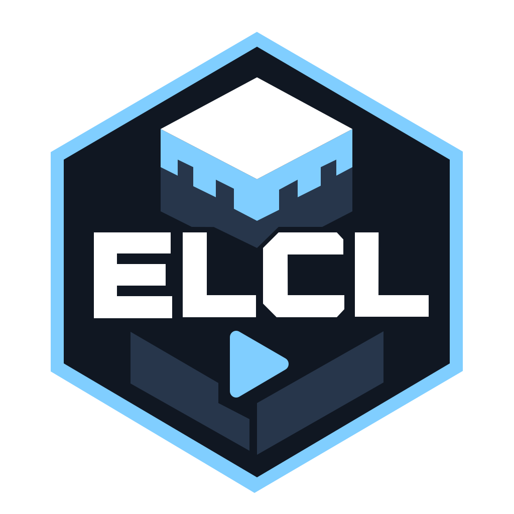

<p align="center">
    
</p>

<h1 align="center">ErhioLab Craft Launcher</h1>

<p align="center">方寸之间，自有天地。</p>

<p align="center">
    
    
    <a href="LICENSE"></a>
    <a href="https://hub.xerj.org/contributors/erhiolab"></a>
</p>

<p align="center">
    <a href="https://elcl.erhio.cn/">官网</a> ·
    <a href="https://elcl.erhio.cn/launcher/">使用指南</a> ·
    <a href="https://elcl.erhio.cn/core/README">核心库文档</a> ·
    <a href="https://github.com/erhiolab/ELCL/issues">反馈问题</a>
</p>

**ELCL** 是一个正在开发的 Minecraft Java 版启动器，使用 .NET 10 与 WPF 构建，运行于 Windows。

这个仓库也包含 **ELCLC**（ErhioLab Craft Launcher Core）：启动器使用的独立核心库，可以在自己的 .NET 项目中引用。

> ELCL 是一次重新出发。2024 年，我还写过一个叫 ECL 的启动器。

## 可以做什么

| 功能 | 说明 |
| --- | --- |
| 下载与安装 | 安装原版，以及 Forge、NeoForge、Fabric、Quilt、LiteLoader 和 OptiFine；支持多文件并发下载与来源回退。 |
| 账户与外观 | 添加 Microsoft 账户或离线账户，双击切换；Microsoft 账户支持头像、三维皮肤预览、皮肤上传与披风切换。 |
| 版本管理 | 管理多个游戏文件夹，记住上次选择；修改版本名称和描述、打开常用目录、补全文件、导出启动脚本或删除版本。 |
| 游戏启动 | 查找和排序 Java，设置内存、窗口、参数与启动前命令；启动前检查账户和游戏文件，支持多个游戏实例。 |
| 任务管理 | 查看安装、下载和启动进度，取消任务、查看失败原因，或终止指定的游戏实例。 |
| 工具与个性化 | 硬件与占用概览、自定义文件下载、缓存清理、内存优化和今日人品；支持主题、容量单位与配置导入导出。 |

各版本的存档、模组和配置独立保存，支持库与资源在游戏根目录共享。

启动选项默认跟随全局，也可以为单个版本指定 Java、内存和高级选项。独立设置与描述随版本目录保存。整合包导入尚未实现；安装加载器不会自动安装模组或 Fabric API。具体操作与限制见[完整使用指南](https://elcl.erhio.cn/launcher/)。

## 开始使用

1. 打开账户管理，添加并选择 Microsoft 账户或离线账户。
2. 在下载页选择游戏版本，按需添加加载器并完成安装。
3. 回到启动页选择版本，点击启动；准备进度和运行状态会显示在任务列表中。

已有游戏可以[添加现有游戏文件夹](https://elcl.erhio.cn/launcher/versions)，不必重新下载。找不到 Java 时，可在“设置 → 启动”中查找或手动添加。

| 想了解的内容 | 文档 |
| --- | --- |
| 账户登录、皮肤和披风 | [账户管理](https://elcl.erhio.cn/launcher/accounts) · [外观设置](https://elcl.erhio.cn/launcher/appearance) |
| 下载、版本与任务 | [下载与安装](https://elcl.erhio.cn/launcher/download) · [版本设置](https://elcl.erhio.cn/launcher/version-settings) · [任务管理](https://elcl.erhio.cn/launcher/tasks) |
| 内存、Java 和启动参数 | [启动设置](https://elcl.erhio.cn/launcher/launch-settings) · [高级选项](https://elcl.erhio.cn/launcher/advanced-options) |
| 日志与数据位置 | [文件与故障排查](https://elcl.erhio.cn/launcher/files) |
| 匿名统计与本地账户数据 | [隐私说明](https://elcl.erhio.cn/launcher/privacy) |

## ELCLC 核心库

核心库以 `net10.0` 为目标框架，不依赖 WPF，可以独立构建。它提供：

- 游戏清单、本地版本扫描、原版下载计划和加载器安装。
- Java 发现与验证、Microsoft 登录、离线 UUID、皮肤和披风请求。
- 多连接下载、版本继承合并、本地库准备与游戏启动参数生成。
- 安装档案维护、Wiki 查询、日志和 JSON 存储。

网络客户端、路径和必要的凭据由调用方提供。界面、应用配置、账户保存和游戏进程管理由自己的程序安排。

目前通过源码项目引用或构建后的 DLL 接入。可从[快速开始](https://elcl.erhio.cn/core/quick-start)运行第一个示例，再查阅[公开 API 索引](https://elcl.erhio.cn/core/api)；完整流程见[安装原版](https://elcl.erhio.cn/core/vanilla-installation)和[准备启动 Minecraft](https://elcl.erhio.cn/core/launch)。

## 从源码运行

启动器需要 **Windows 与 .NET 10 SDK**。在仓库根目录运行：

```powershell
dotnet build .\ErhioLab.Craft.Launcher.slnx
dotnet run --project .\src\ErhioLab.Craft.Launcher\ErhioLab.Craft.Launcher.csproj
```

Rider 用户也可以打开解决方案，选择共享配置 **Run ELCL** 进行运行或调试。

只构建核心库：

```powershell
dotnet build .\ErhioLab.Craft.Launcher.Core.slnx -c Release
```

构建产物位于 `artifacts/build/`，中间文件位于 `artifacts/obj/`。

### 生成发布文件

在 Windows 上执行：

```powershell
powershell -NoProfile -ExecutionPolicy Bypass -File .\tools\publish-elcl.ps1
```

也可使用 Rider 的 **Publish ELCL** 配置。脚本将文件输出到 `artifacts/publish/`：

| 产物 | 使用要求 |
| --- | --- |
| `ELCL-<版本>-win-x64-framework-dependent.exe` | 需要安装 .NET 10 Windows Desktop Runtime。 |
| `ELCL-<版本>-win-x64-self-contained.exe` | 自带 .NET 运行时。 |
| `ErhioLab.Craft.Launcher.Core.dll` | 供其他 .NET 10 项目引用的核心库。 |

两种启动器发布方式都需要为游戏准备兼容的 Java。

## 参与开发

### 仓库结构

```text
src/
├─ ErhioLab.Craft.Launcher/       Windows 启动器
└─ ErhioLab.Craft.Launcher.Core/  独立核心库
web/
└─ docs/                        官网与文档源文件
tools/                          发布脚本
.run/                           Rider 运行与发布配置
```

修改前请阅读 [AGENTS.md](AGENTS.md)。新增功能或改变使用方式时，同步更新对应文档；核心公开方法需要说明和调用示例。

### 界面翻译

语言文件位于 [`Languages/`](src/ErhioLab.Craft.Launcher/Languages/)，目前提供简体中文。构建时自动嵌入该目录下的所有语言 JSON；新增语言只需添加同结构的 `语言代码.json`，无需逐个修改项目引用。缺少的词条会回退到简体中文。

词条按功能命名，例如 `account.addAccount`。翻译时保留资源键、格式占位符与文件筛选规则；界面文字应简洁、易懂，说明用户需要知道的用途和操作。

### 本地预览官网与文档

需要 **Node.js 20 或更新版本**，包管理器使用 **pnpm**：

```powershell
cd web
pnpm install
pnpm dev
```

打开 <http://127.0.0.1:3000/>。运行 `pnpm build` 可生成静态站点，输出到 `web/artifacts/docs-site/`。

## 鸣谢

- [PCL](https://github.com/Meloong-Git/PCL)：界面设计与部分代码参考。
- [Prism Launcher](https://github.com/PrismLauncher/PrismLauncher)：部分代码参考。
- [BMCLAPI](https://bmclapidoc.bangbang93.com/)：游戏与加载器的版本信息、下载镜像。
- [Minecraft Wiki](https://zh.minecraft.wiki/)：游戏版本信息与更新说明。

第三方图标来源见[图标说明](src/ErhioLab.Craft.Launcher/Assets/Credits/README.md)，随程序分发的兼容补丁来源与许可见[启动补丁说明](src/ErhioLab.Craft.Launcher/Assets/Launch/README.md)。

## 许可证

本项目采用 [GNU GPL v3](LICENSE)。第三方代码、标识和资源遵循各自的许可声明。

## Star 历史

<a href="https://star-history.com/#erhiolab/ELCL&amp;Date">
    <picture>
        <source media="(prefers-color-scheme: dark)" srcset="https://api.star-history.com/svg?repos=erhiolab/ELCL&amp;type=Date&amp;theme=dark" />
        <source media="(prefers-color-scheme: light)" srcset="https://api.star-history.com/svg?repos=erhiolab/ELCL&amp;type=Date" />
        
    </picture>
</a>
